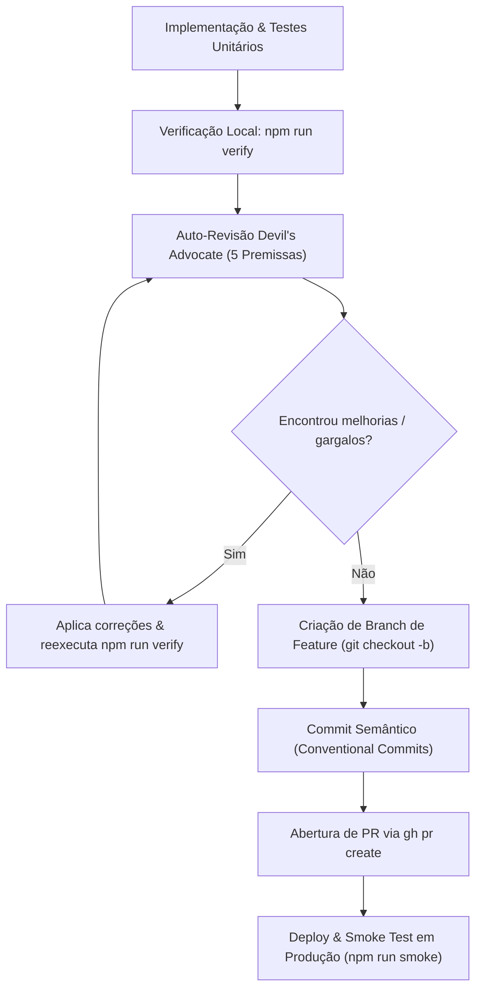

# Harness de Engenharia de Software: Ciclo de Desenvolvimento, Revisão e Abertura de PR

Este documento define a diretriz canônica e obrigatória para todo o ciclo de engenharia de software no projeto **Ata Sacramental**. Aplica-se a todos os desenvolvedores humanos e agentes de IA (Antigravity, Claude Code, Cursor, Windsurf, Devin).

---

## 📌 Regra Fundamental de Encerramento de Ciclo

> [!IMPORTANT]
> **Toda e qualquer implementação, refatoração ou correção de defeito DEVE ser obrigatoriamente concluída com:**
> 1. Uma **Auto-Revisão Crítica** guiada pelas 5 Premissas de Engenharia de Software (atuando ativamente como *Devil's Advocate*).
> 2. A resolução justificada de todos os apontamentos acordados.
> 3. A aprovação da suíte unificada de verificação (`npm run verify`).
> 4. Um **Pull Request (PR) aberto** para a branch principal (`main`) seguindo as melhores práticas de mercado e o padrão de Conventional Commits.

---

## 🏛️ As 5 Premissas de Engenharia de Software para Revisão

Todas as decisões técnicas e revisões de código devem ser avaliadas sob estas premissas:

### 1. Maintainability (Manutenibilidade & S.O.L.I.D.)
- O código deve ser limpo, modular e aderente aos princípios **S.O.L.I.D. e Clean Code**.
- Componentes e funções devem possuir **responsabilidade única** (Single Responsibility Principle). Modais, portais e formulários devem ser desacoplados da lógica das telas.
- Eliminação completa de código morto, logs de depuração e variáveis não utilizadas.

### 2. Consistency (Consistência Arquitetural)
- Respeito estrito às 6 camadas de arquitetura do projeto (`src/services/`, `src/contexts/`, `src/hooks/`, `src/components/`, `src/pages/`, `src/data/`).
- **Fronteira Arquitetural Inviolável**: Componentes e telas **NUNCA** acessam Firebase/Firestore diretamente; todo acesso deve residir exclusivamente em `src/services/`.
- Antes de introduzir uma nova abstração, helper ou biblioteca, certifique-se de que não existe padrão equivalente no projeto e mantenha alinhamento com a arquitetura estabelecida.
- Paridade estética e de design system (Tailwind/CSS tokens, estados interativos, acessibilidade WAI-ARIA).

### 3. Performance (Desempenho & Otimização)
- O tempo de resposta percebido da interface deve ser instantâneo (**0ms percebidos** com cache local e atualização otimista).
- Estruturas de dados em memória eficientes ($O(1)$ via `Map`/`Set` em listas de membros, famílias e frequências).
- Eliminação de cascatas de rede (*waterfalls*): utilizar `Promise.all` em carregamentos paralelos de dados.
- Renderização eficiente: portais flutuantes fora de contêineres com overflow e limitação de nós no DOM (ex.: listas de sugestões paginadas ou truncadas).

### 4. Security & PII (Segurança e Proteção de Dados)
- O sistema deve ser resiliente contra ameaças de segurança por padrão.
- **Proteção Estrita de PII**: Arquivos de planilhas de membros (`.xlsx`, `.csv`, pastas `import/`) **NUNCA** devem ser versionados no Git.
- Todas as regras de segurança no `firestore.rules` devem ser respeitadas e validadas por `unitId` e permissões de sessão.
- Sanitização de entradas do usuário e prevenção de injeções em buscas textuais.

### 5. Cost-Effectiveness (Custo Operacional Firebase)
- Minimização de leituras no Firestore: uso de cache, agregação e leitura única de documentos de configuração/memória.
- **Persistência Preguiçosa (*Lazy Writes*)**: Gravações só devem ocorrer se o formulário ou dado estiver efetivamente alterado (`dirty === true`).
- Uso de `writeBatch` para operações em massa, evitando disparos dispersos de transações.

---

## 😈 Postura de *Devil's Advocate* na Revisão de Código

Durante a revisão do diff antes de abrir o PR:
1. **Questione ativamente as alterações**: Critique a própria análise para confirmar se cada problema identificado é de fato um problema real que deve ser corrigido ou se constitui *overengineering*.
2. **Foco no melhor resultado do produto**: O objetivo não é estar certo ou errado, mas alcançar a solução mais sustentável, alinhada às 5 premissas de desenvolvimento.
3. **Correção e Justificativa**: Corrija todos os problemas confirmados, independentemente da severidade, e documente a justificativa técnica de cada decisão no corpo do PR.

---

## 🔄 Fluxo Operacional: Do Código ao Pull Request



### Comandos Padronizados

1. **Validação da Suíte Unificada**:
   ```bash
   npm run verify
   ```
2. **Criação da Branch e Commit**:
   ```bash
   git checkout -b feat/nome-da-funcionalidade
   git add .
   git commit -m "feat(modulo): descricao concisa da melhoria"
   ```
3. **Abertura do Pull Request**:
   ```bash
   gh pr create --base main --head feat/nome-da-funcionalidade --title "feat: ..." --body "..."
   ```
4. **Deploy & Smoke Test (quando aplicável)**:
   ```bash
   firebase deploy --only hosting
   npm run smoke
   ```
